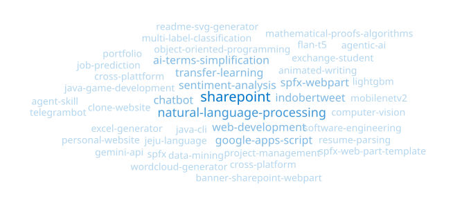

<div align="center">

# *Hi, I'm Bisma*

<a href="https://github.com/Bisma1hsan"></a>

### <sup>LET'S CONNECT!</sup>

connect with me on:

[](https://www.linkedin.com/in/bisma-ihsan-fausta)
```
[](https://codepen.io/stefanigifta)
[](https://instagram.com/stefanigifta)
```
[](mailto:bismaihsnfs@gmail.com)

<br>

---

<br>

### <ins><sup>TOPICS I'VE WORKED ON</sup></ins>

<a href="https://github.com/marketplace/actions/word-cloud-repo-topics"></a>

### <ins><sup>MY TECH STACK</sup></ins>

<br>

<sup>`PERSONAL FAVS:`ㅤ</sup>


<br>

<details>
<summary><ins><sup>OTHER TECHNOLOGIES USED:</sup></ins></summary>

<br>

<sup>`Languages`ㅤ</sup>


<sup>`Frontend`ㅤ</sup>


<sup>`Backend`ㅤ</sup>


<sup>`Databases & Cloud`ㅤ</sup>


<sup>`Data Science & AI`ㅤ</sup>


<sup>`Design & Productivity`ㅤ</sup>

[](https://adobe.com)


<sup>`DevOps & Version Control`ㅤ</sup>


</details>

<br>

---

<br>

### <ins><sup>FUN FACTS</sup></ins>

<br>

```
<!--START_SECTION:fun-facts-->
I'm an afternoon warrior

```text
Morning                  109 commits         ███░░░░░░░░░░░░░░░░░░░░░░   10.52%
Daytime                  398 commits         ██████████░░░░░░░░░░░░░░░   38.42%
Evening                  363 commits         █████████░░░░░░░░░░░░░░░░   35.04%
Night                    166 commits         ████░░░░░░░░░░░░░░░░░░░░░   16.02%
```

I'm most productive on Friday

```text
Sunday                   157 commits         ████░░░░░░░░░░░░░░░░░░░░░   15.15%
Monday                   123 commits         ███░░░░░░░░░░░░░░░░░░░░░░   11.87%
Tuesday                  160 commits         ████░░░░░░░░░░░░░░░░░░░░░   15.44%
Wednesday                155 commits         ████░░░░░░░░░░░░░░░░░░░░░   14.96%
Thursday                 139 commits         ███░░░░░░░░░░░░░░░░░░░░░░   13.42%
Friday                   190 commits         █████░░░░░░░░░░░░░░░░░░░░   18.34%
Saturday                 112 commits         ███░░░░░░░░░░░░░░░░░░░░░░   10.81%
```

My most used language is JavaScript

```text
JavaScript               12 repos            ████████░░░░░░░░░░░░░░░░░   33.33%
HTML                     9 repos             ██████░░░░░░░░░░░░░░░░░░░   25.00%
TypeScript               4 repos             ███░░░░░░░░░░░░░░░░░░░░░░   11.11%
Jupyter Notebook         3 repos             ██░░░░░░░░░░░░░░░░░░░░░░░   08.33%
CSS                      3 repos             ██░░░░░░░░░░░░░░░░░░░░░░░   08.33%
Blade                    2 repos             █░░░░░░░░░░░░░░░░░░░░░░░░   05.56%
Python                   1 repo              █░░░░░░░░░░░░░░░░░░░░░░░░   02.78%
Java                     1 repo              █░░░░░░░░░░░░░░░░░░░░░░░░   02.78%
C++                      1 repo              █░░░░░░░░░░░░░░░░░░░░░░░░   02.78%
```


 *Last updated on Thu, 5 Feb 2026 20:13:48 WIB*
<!--END_SECTION:fun-facts-->

<!-- <br>

### <ins><sup>CHECK OUT MY FAVORITE PROJECTS BELOW</sup></ins>

<br>


</div> -->

<!--
stefani-gifta/stefani-gifta is a ✨ _special_ ✨ repository because its<sup>`README.md`<sup>(this file) appears on your GitHub profile.

Here are some ideas to get you started:

- 🔭 I’m currently working on ...
- 🌱 I’m currently learning ...
- 👯 I’m looking to collaborate on ...
- 🤔 I’m looking for help with ...
- 💬 Ask me about ...
- 📫 How to reach me: ...
- 😄 Pronouns: ...
- ⚡ Fun fact: ...

Helped by https://gprm.itsvg.in/
-->
